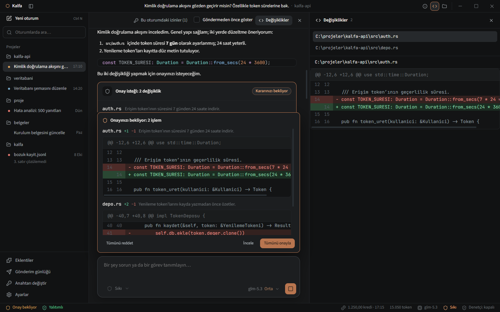
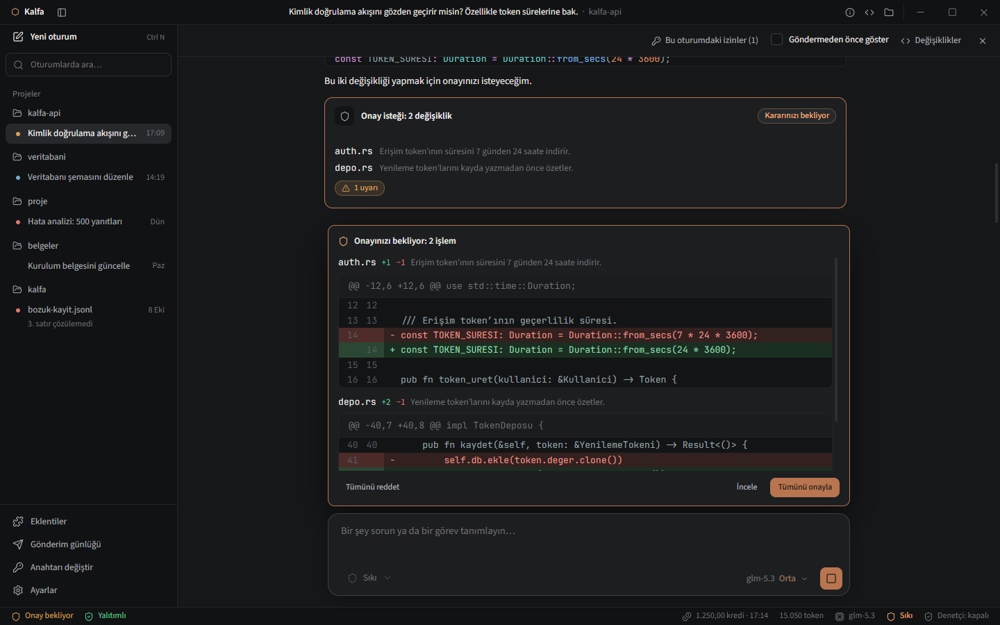
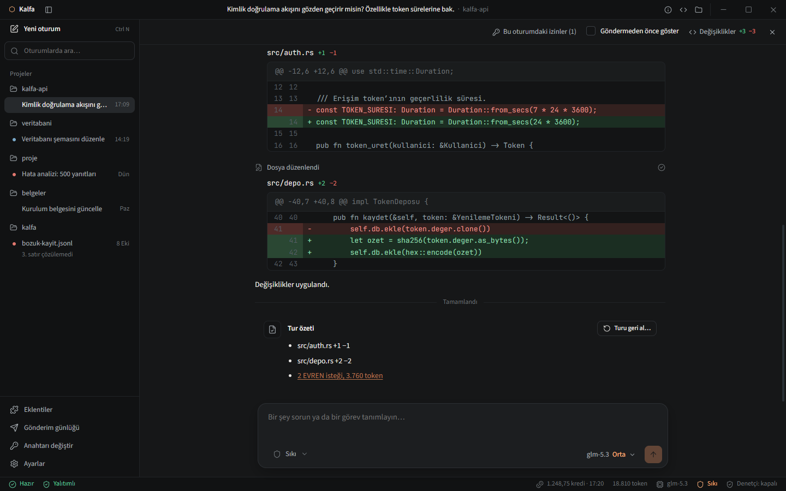
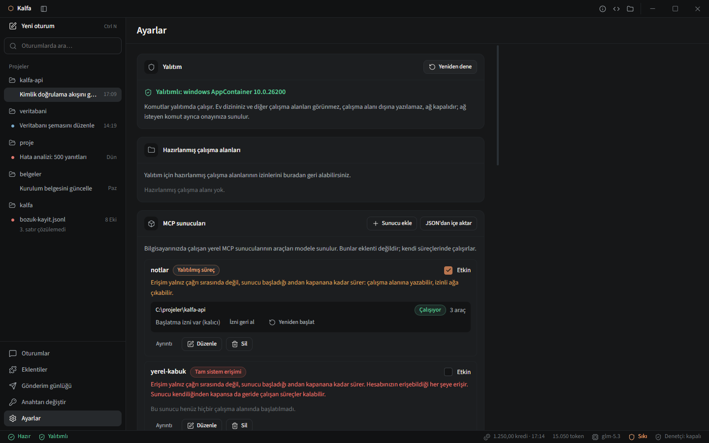
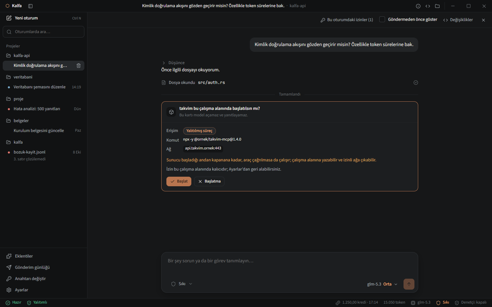
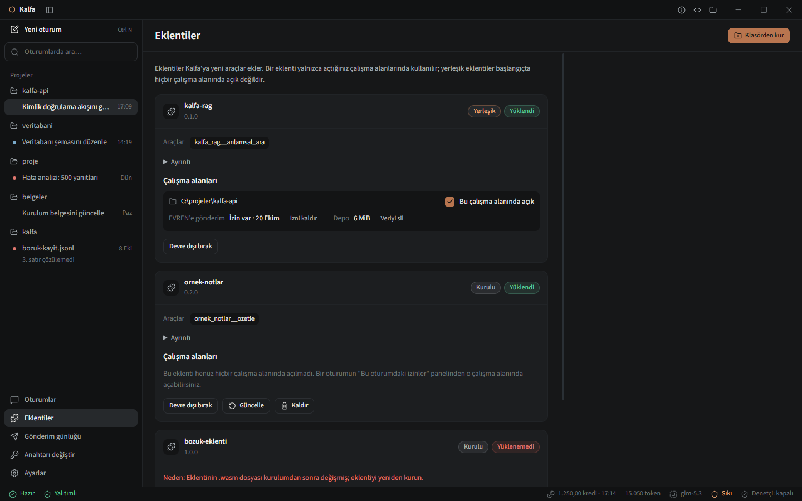
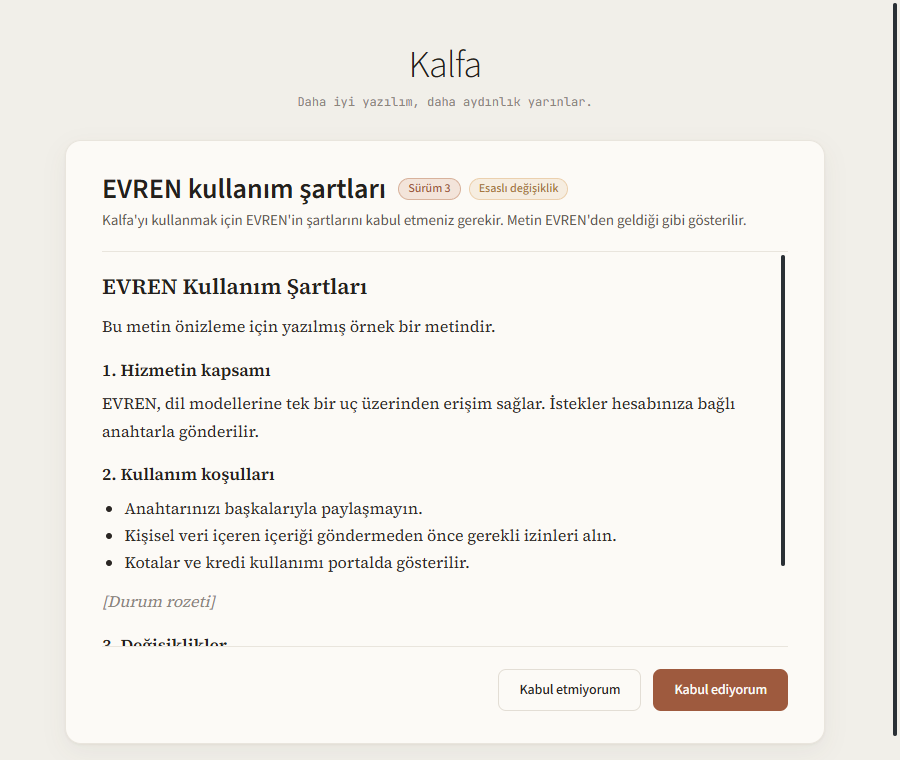

<div align="center">

# Kalfa

**EVREN LLM Gateway için Türkçe, açık kaynak masaüstü ajanı**

Kodunuzu okur, düzenler, komut çalıştırır ve projenizde arama yapar.
Her adımı size gösterir; son söz her zaman sizindir.

[](https://github.com/heimdilon/kalfa/actions/workflows/ci.yml)
[](LICENSE)




</div>

---

## İçindekiler

- [Neden Kalfa?](#neden-kalfa)
- [Kurulum](#kurulum)
- [Öne çıkanlar](#öne-çıkanlar)
- [Güvenlik modeli](#güvenlik-modeli)
- [Durum](#durum)
- [Kaynaktan derleme](#kaynaktan-derleme)
- [Mimari](#mimari)
- [Belgeler](#belgeler)
- [Katkı](#katkı)
- [Lisans](#lisans)

## Neden Kalfa?

EVREN'in model filosu Türkçe için güçlü; ama bu filoyu bir ajan aracı içinde
kullanmanın yerli bir yolu yoktu. Mevcut ajan araçları başka sağlayıcılara
bağlı, İngilizce öncelikli ya da EVREN'in kendine özgü sözleşmesini bilmiyor:
şart kapısı, kredi başlıkları, `error.evren` alt nesnesi ve `reasoning` alanı.

Kalfa bu boşluğu doldurur: arayüzü, iletileri ve kod tabanı Türkçe olan,
EVREN'e özgü davranışları bilen ve güvenliği varsayılan yapan bir masaüstü
ajanıdır.

**Adı nereden geliyor?** Ahilik geleneğinden: *çırak → kalfa → usta*. Kalfa,
ustanın yönlendirmesiyle iş yapan yetkin zanaatkârdır. Ürünün izin modeli de
budur: yetenekli, ama son söz sizin.

## Kurulum

Ön sürümler [GitHub Releases](https://github.com/heimdilon/kalfa/releases)
sayfasındadır (son sürüm: **v0.1.1**):

| Platform | Paket |
|---|---|
| Windows (x64) | `Kalfa_<sürüm>_x64-setup.exe` (NSIS kurucusu; yalıtım hazırlığı için bir kez UAC ister) |
| Debian 12+, Ubuntu 24.04+ | `Kalfa_<sürüm>_amd64.deb` |
| Fedora ve RPM tabanlı dağıtımlar | `Kalfa-<sürüm>-1.x86_64.rpm` |

Paketleri indirdikten sonra `SHA256SUMS` ile doğrulayın. İlk açılışta EVREN
anahtarınız istenir ve EVREN'in güncel kullanım şartları gösterilir. Kaynaktan
derlemek için [aşağıya](#kaynaktan-derleme) bakın.

## Öne çıkanlar

### Her değişikliği önce siz görürsünüz

Kalfa bir dosyayı değiştirmeden ya da komut çalıştırmadan önce ne yapacağını,
nerede yapacağını ve hangi verinin dışarı çıkacağını gösterir. Onay kartı
konuşmanın içinde, dosya başına diff'iyle gelir; isterseniz İncele ile ayrıntılı
sayfayı açarsınız. Onay, gösterilen işleme bağlıdır: dosya onaydan sonra
değişirse işlem yapılmaz. Değişiklikleri tek tek seçebilir, gerekçe yazarak
reddedebilirsiniz.



### Beş izin kipi, Otomatik dahil

İnceleme, Sıkı, Proje ve Serbest kiplerine ek olarak **Otomatik** kipte onay
isteyen yalıtımlı komutları ve MCP çağrılarını bir hakem model (`clef`)
değerlendirir. Güvenli bulduğunu çalıştırır, riskli bulduğunu reddeder, emin
olamadığını size bırakır; her karar konuşmada tek satırla görünür. Gizli dosya,
korumalı yol ya da geri alınamaz yazma gibi işlemler hakeme hiç gitmez, her
zaman size sorulur. Hakeme ulaşılamazsa işlem çalışmaz, onay kartı açılır.

### Tur özeti ve geri alma

Her turun sonunda hangi dosyaların değiştiği ve kaç EVREN isteği gönderildiği
özetlenir; araç kartları değişikliğin diff'ini gösterir. Bir turun dosya
değişikliklerini tek düğmeyle geri alabilirsiniz. Sağ panelden turun
değişikliklerine ve çalışma alanının dosyalarına salt okunur göz atarsınız.



### Uzun oturumlar

Oturumun kendi istek ya da token tavanı yoktur; dış sınır EVREN'in günlük ve
dakikalık kotasıdır. Bağlam dolmaya yaklaşınca konuşmanın geçmişi tek bir
özete dönüşür ve oturum o özetle sürer. `/compact [talimat]` ile özetlemeyi
elle de başlatabilirsiniz. Özet veri olarak sarılır; araç çıktısından sızan bir
talimat özette de talimat sayılmaz.

### Komutlar yalıtımda çalışır

Kabuk komutları işletim sistemi düzeyinde yalıtılır: Linux'ta bubblewrap ve
seccomp, Windows'ta AppContainer ve Job Object. Komut yalnız çalışma alanını
görür; ev dizini ve diğer projeler görünmez, ağ varsayılan olarak kapalıdır.
Ağ isteyen komut yalnızca izin listesindeki adreslere, Kalfa'nın vekili
üzerinden çıkar.



### Yerel MCP sunucuları

Bilgisayarınızdaki MCP sunucularının araçları modele sunulur. Bir sunucu bir
çalışma alanında ilk kez başlayacağında Kalfa erişim kipini, komutu ve ağ
adreslerini gösterip sorar; bu kartı model açamaz ve yanıtlayamaz. Sunucular
yalıtılmış süreçte ya da açık uyarıyla tam erişimle çalışır; izinleri
Ayarlar'dan geri alabilirsiniz.



### WebAssembly eklentileri ve Türkçe anlamsal arama

Eklentiler WebAssembly Component Model (WIT) sözleşmesiyle, bellek ve süre
sınırları içinde çalışır; yalnız manifestlerinde izin verilen dosyaları
okuyabilirler. Yerleşik `kalfa-rag` eklentisi projenizi EVREN'in gömme ve
yeniden sıralama modelleriyle indeksler ve Türkçe doğal dil sorgularına
kaynaklı yanıt verir. Bir eklenti bir çalışma alanından ilk kez veri
göndereceğinde Kalfa bunu ayrıca sorar.



### Şeffaf EVREN kullanımı

- **Gönderim günlüğü:** EVREN'e giden her istek, kaynağıyla (sohbet, araç
  sonucu, eklenti) kaydedilir.
- **Göndermeden önce göster:** İsterseniz her istek gönderilmeden önce size
  sunulur.
- **Durum çubuğu:** Son gözlenen kredi bakiyesi, oturumun token kullanımı,
  yönlendirilen model ve izin kipi her an görünür.
- **Şartlar:** EVREN kullanım şartları ilk açılışta özetlenmeden gösterilir.
  Kalfa şartları hiçbir zaman sizin yerinize kabul etmez.



> Ekran görüntüleri arayüzün geliştirme önizlemesinden, örnek verilerle
> alınmıştır.

## Güvenlik modeli

| | |
|---|---|
| **İzin kipleri** | İnceleme, Sıkı, Proje, Serbest ve Otomatik. Kipi yükseltmek yerel bir pencerede onay ister, düşürmek istemez. Kalıcı bir "her şeye izin ver" yoktur. Otomatik kipin hakemi kapalı düşer: hata ya da belirsizlikte işlem çalışmaz, size sorulur. |
| **Bağlı onay** | Onay gösterilen işleme bağlıdır; dosya ya da bağlantı onaydan sonra değişirse işlem durur. |
| **Çalışma alanı sınırı** | Dosya araçları çalışma alanından dışarı çıkamaz; sembolik bağlantılar ve Windows junction'ları izlenmez. |
| **Gizli dosyalar** | `.env`, anahtar ve kimlik bilgisi dosyaları gibi kalıplara uyan bir dosyayı okumak her kipte onay ister ve kart içeriğin EVREN'e gideceğini açıkça söyler. Arama araçları bu dosyaların içeriğini döndürmez; yalıtımdaki komutlar onları okuyamaz. |
| **Güvenlik denetçisi** | Dış kaynaklı araç sonuçları modele gitmeden önce ayrı bir modelle prompt injection için denetlenebilir (kapalı, uyar, katı). |
| **Arayüz** | Sıkı CSP; ham HTML basılmaz; Markdown güvenli biçimde işlenir. Pencerelere yalnız ihtiyaç duydukları komut yetkileri verilir. |
| **Anahtar** | EVREN anahtarı işletim sisteminin kimlik deposunda saklanır ve ana pencereye hiç girmez. |

Ayrıntı: [üst tasarım belgesi §7](docs/superpowers/specs/2026-09-21-kalfa-design.md).
Bir güvenlik açığı bulduysanız lütfen herkese açık bir issue açmak yerine
GitHub'ın özel güvenlik bildirimini kullanın (**Security → Report a
vulnerability**); ayrıntı [SECURITY.md](SECURITY.md)'de.

## Durum

Kalfa etkin geliştirme altındadır; sürümler şimdilik ön sürüm olarak
yayımlanır. v1 kapsamı aşamalar hâlinde teslim edilir:

| Aşama | Kapsam | Durum |
|---|---|---|
| 1 | EVREN istemcisi, oturum çekirdeği, dosya araçları, Tauri ve Svelte kabuğu | ✅ |
| 2 | Kabuk aracı; Linux (bubblewrap, seccomp) ve Windows (AppContainer) yalıtımı; Windows kurucusu | ✅ |
| 3 | Tur özeti ve geri alma, gönderim günlüğü, güvenlik denetçisi, ağ çıkışı | ✅ |
| 4 | WebAssembly eklenti çalışma zamanı, `kalfa-rag`, eklenti arayüzü | ✅ |
| 5 | Bağlam yönetimi ve compact, bütçesiz oturum, Linux paketleri (`.deb`, `.rpm`), sürüm akışı | ✅ |
| Sonrası | Yerel MCP, masaüstü arayüzü (sağ panel, konuşmada onay, özel başlık çubuğu), Otomatik izin kipi | ✅ |
| Sırada | Uzak MCP ve OAuth, web getirme, arka plan süreçleri, proje talimatları | ⏳ |

Güncel devam noktası: [docs/GELISTIRME_DURUMU.md](docs/GELISTIRME_DURUMU.md).

## Kaynaktan derleme

**Gereksinimler**

- Rust: sürüm `rust-toolchain.toml` ile sabittir (1.98.1, `wasm32-wasip2`
  hedefiyle); `rustup` kendiliğinden kurar.
- Node.js `^22.22.2 || >=24.15.0`.
- **Linux:** `libwebkit2gtk-4.1-dev` ve komut yalıtımı için `bubblewrap`.
- **Windows:** WebView2 (Windows 11'de hazır gelir).

**Uygulamayı çalıştırma**

```sh
cd ui && npm ci && npm run build && cd ..
cargo run -p kalfa --locked --features tauri/custom-protocol
```

İlk açılışta EVREN anahtarınız istenir ve EVREN'in güncel kullanım şartları
gösterilir.

**Windows kurucusu**

```sh
cd ui && npm ci
node ../crates/kalfa/kurucu/derle.mjs
```

Kurucu `target/release/bundle/nsis/` altında oluşur. Makine geneli kurulum
yapar ve yalıtım hazırlığı için UAC ister. Ayrıntı:
[crates/kalfa/kurucu/README.md](crates/kalfa/kurucu/README.md).

**Testler**

```sh
cargo test --workspace --locked
cargo clippy --workspace --all-targets --locked -- -D warnings
cargo fmt --all -- --check
cd ui && npm run check && npm test && npm run build
```

Varsayılan testler sahte sağlayıcılar ve yerel HTTP sunucularıyla çalışır;
EVREN anahtarı gerekmez. Canlı API testleri `#[ignore]` ile ayrılmıştır.
Gerçek yalıtım testleri ve `tauri-driver` ile uçtan uca testler için
[AGENTS.md](AGENTS.md)'deki "Kurulum ve doğrulama" bölümüne bakın.

## Mimari

Arayüzden bağımsız bir Rust çekirdeği, serileştirilebilir bir komut/olay
sınırı üzerinden ince bir Tauri kabuğuyla konuşur.

| Crate | Görev |
|---|---|
| [`kalfa-evren`](crates/kalfa-evren) | EVREN istemcisi: istek/yanıt tipleri, katmanlı SSE ayrıştırıcı, şart uçları, kredi gözlemi |
| [`kalfa-core`](crates/kalfa-core) | Oturum çekirdeği: ajan döngüsü, izin kipleri ve hakem, bağlı onay, compact, JSONL kayıt ve kurtarma |
| [`kalfa-tools`](crates/kalfa-tools) | Dosya araçları (`cap-std` ile) ve kabuk aracı |
| [`kalfa-mcp`](crates/kalfa-mcp) | Yerel MCP için sınırlı stdio taşıması ve istemci |
| [`kalfa-sandbox`](crates/kalfa-sandbox) | Komut çalıştırma, süreç sınırları, Linux ve Windows yalıtımı, ağ vekili |
| [`kalfa-yalitim`](crates/kalfa-yalitim) | Windows yalıtımını kuran yönetici yardımcısı |
| [`kalfa-plugin`](crates/kalfa-plugin) | wasmtime tabanlı eklenti çalışma zamanı: manifest, sınırlar, depo |
| [`kalfa-plugin-sdk`](crates/kalfa-plugin-sdk) | Eklenti yazarlarının SDK'sı ve WIT sözleşmesi |
| [`kalfa-rag`](crates/kalfa-rag) | Türkçe anlamsal arama eklentisi |
| [`kalfa-uygulama`](crates/kalfa-uygulama) | Tauri'siz uygulama mantığı: oturumlar, olay köprüsü, yalıtım durumu |
| [`kalfa`](crates/kalfa) | Tauri v2 kabuğu: pencereler, komutlar, yetkiler |
| [`ui/`](ui) | Svelte 5 + TypeScript arayüzü |

Tasarım varsayıma değil, canlı API'ye atılmış isteklere dayanır. Ham yanıtlar
[`research/evren-probe/`](research/evren-probe/) altında durur ve ayrıştırıcı
testleri bunlara karşı koşar.

## Belgeler

- [Üst tasarım belgesi](docs/superpowers/specs/2026-09-21-kalfa-design.md)
- [Aşama tasarımları](docs/superpowers/specs/) ve [uygulama planları](docs/superpowers/plans/)
- [Ölçüm ve prototip raporları](docs/superpowers/bulgular/)
- [Geliştirme durumu](docs/GELISTIRME_DURUMU.md)
- [EVREN modeller ve API başvurusu](docs/basvuru/evren-modeller-ve-api.md) — 23 Ekim 2026 tarihli resmî sayfa sözleşmeleri ve açık kalan alanlar.

## Katkı

Katkılarınızı bekliyoruz. Başlamadan önce [AGENTS.md](AGENTS.md)'yi okuyun;
kod kuralları ve doğrulama komutları oradadır. Kısaca:

- Koddaki adlar, açıklamalar, testler ve commit mesajları Türkçedir; commit
  mesajları önekle başlar (`çekirdek:`, `araçlar:`, `ui:`, `docs:` …).
- Her değişiklik testiyle gelir; yeni bir güvenlik sınırı testsiz eklenmez.
- Değişiklikler PR ile gönderilir ve CI'dan geçmelidir.

Katkılar, katkı yapılan kısmın lisansıyla kabul edilir (Apache-2.0 §5).

## Lisans

[Apache-2.0](LICENSE) © 2026 Orkun Koray Güngör ([NOTICE](NOTICE)).

`kalfa-plugin-sdk` ve eklenti sözleşmesinin WIT dosyaları ayrıca
[LLVM istisnası](LICENSE-LLVM-exception) taşır (`Apache-2.0 WITH
LLVM-exception`): eklentinizi derleyip dağıtırken lisans ya da NOTICE dosyası
eklemeniz gerekmez; eklentinizin lisansını siz seçersiniz.

---

> **Muafiyet:** Kalfa bağımsız bir açık kaynak çalışmasıdır. T.C.
> Cumhurbaşkanlığı Savunma Sanayii Başkanlığı veya EVREN platformu ile resmî
> bir bağı, onayı ya da desteği yoktur. "EVREN uyumlu" ifadesi yalnızca teknik
> uyumluluğu tanımlar.
