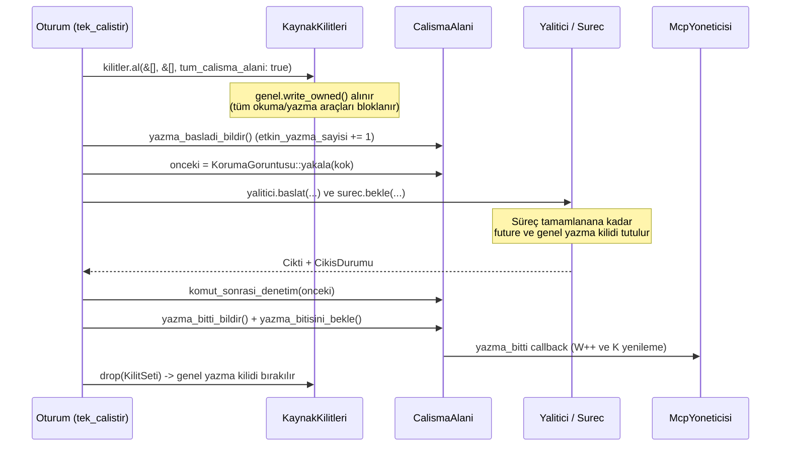
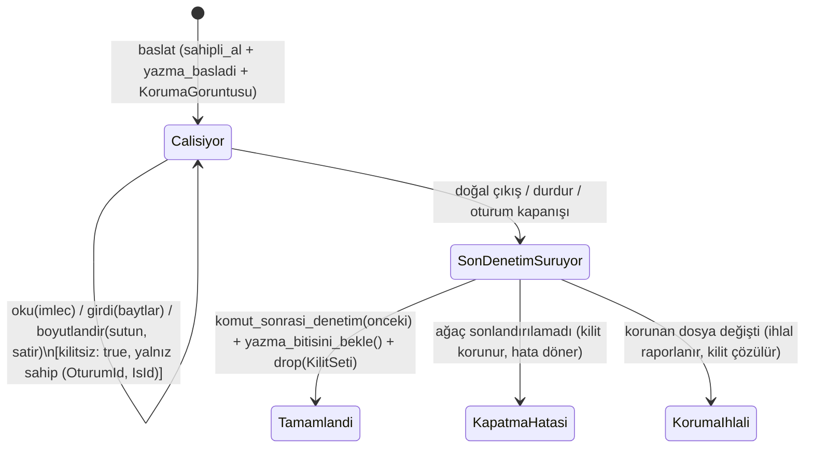

# Kalfa Yetenek Programı — Hat 03 (G2a / G2b / G2c): Süreç Sahipliği, Kilit ve Terminal Deneyi ve Uygulama Raporu (2026-10-20)

**Soru:** Kalfa'nın süreç ve terminal hattı (`docs/superpowers/plans/2026-10-20-kalfa-yetenek-03-surec-terminal.md`, Görev 1–6) kapsamında ürün uygulamasına (`G2b` arka plan işleri ve `G2c` etkileşimli PTY/ConPTY) geçmeden önce dört temel teknik soru deneysel olarak doğrulandı ve ardından ürün katmanları iki platformda gerçek yalıtımla uygulandı:

1. Mevcut `kabuk` aracının (`KabukAraci`) çalışma alanı kilidi (`KaynakKilitleri`), yazma penceresi (`yazma_basladi_bildir` / `yazma_bitisini_bekle`) ve son koruma taraması (`komut_sonrasi_denetim`) süreç arka plana alındığında nasıl davranır; kontrol çağrıları (`oku`/`girdi`/`durdur`) genel kilidi beklerse kilitlenme (`deadlock`) oluşur mu?
2. Süreç çalışırken kilidi ve son denetimi erken bırakmak korunan dosyalar (`.git`, `.kalfa`, `.mcp.json` vb.) ve eşzamanlı `dosya_yaz` üzerinde hangi güvenlik açığını doğurur?
3. Linux (`bwrap` + `seccomp` + `PR_SET_CHILD_SUBREAPER`) ve Windows (`AppContainer` + `Job Object`) yalıtım sınırları içinde borulu stdin/stdout, `Ctrl+C` (`\x03`) ve EOF, PTY (`openpty`) / ConPTY (`CreatePseudoConsole`) açılışı ve yeniden boyutlandırma (`TIOCSWINSZ` / `ResizePseudoConsole`), torun süreç (`descendant process`) ağacı sonlandırma ve dolu çıktı (`full output`) altında kapanış nasıl çalışır?
4. Aynı çalışma alanında bir süreç çalışırken dosya düzenleme (`S06`) için hangi kilit ve yaşam döngüsü tasarımı seçilmelidir?

## 1. Mevcut Kabuk Kilidi ve Süreç Sahipliği Akışı (Görev 1)

Mevcut üretim kodunda (`crates/kalfa-core/src/oturum/arac_asamasi.rs`, `crates/kalfa-core/src/kilit.rs` ve `crates/kalfa-tools/src/kabuk/mod.rs`) tek seferlik `kabuk` çağrısının kilit ve koruma yaşam döngüsü aşağıdaki gibidir:

### Tespit Edilen İki Kök Sorun

1. **Erken Dönüşün Koruma ve Yarış İhlali (`G1.2`):**
   `KabukAraci::calistir_akisli` süreci başlatıp henüz süreç bitmeden dönerse:
   - `_kilit` (`KilitSeti`) düşer ve `KaynakKilitleri.genel` yazma kilidi serbest kalır.
   - `komut_sonrasi_denetim(onceki)` süreç henüz çalışırken erken çalıştığı için, arka plan sürecinin veya torun sürecinin dönüşten sonra `.git/config`, `.git/hooks`, `.kalfa` ya da `.mcp.json` üzerinde yapacağı değişiklikler denetimden kaçar.
   - `_yazma_bitis` erken düştüğü için `McpYoneticisi` yazma penceresinin kapandığını varsayar; arka plan süreci dosyaları değiştirmeye devam ederken MCP `K` koruma görüntüsü ve `dosya_yaz` araçları yarış (`race condition`) içine girer.
2. **Kontrol Çağrısının Kilitlenmesi — Deadlock (`G1.1`):**
   Süreç boyunca `KaynakKilitleri.genel` yazma kilidi tutulmaya devam edildiğinde:
   - Eşzamanlı gelen bir `dosya_yaz("src/lib.rs")` çağrısı (`tum_calisma_alani: false`) `genel.read_owned()` kuyruğunda bekler.
   - Ardından gelen `komut_oku`, `komut_girdi` veya `komut_durdur` kontrol çağrısı eğer normal araçlar gibi `kilitsiz: false` ile `KaynakKilitleri::al` kapısına girerse, çalışan sürecin tuttuğu `genel` yazma kilidinin arkasında sonsuza dek bekler (**kilitlenme / deadlock**).

## 2. Ortam ve Yöntem

- **Çalışma yolu ve dal:** `C:/Users/kor_a/kalfa-hat-03`, dal `codex/plan-yetenek-surec-terminal`, taban HEAD `2e275a1d2cddd5d0c648f013625e23488094396c`.
- **Platformlar:**
  - **Windows:** Windows 11 (`10.0.26200`), Rust `1.98.1`, gerçek `AppContainer` profili (`CreateAppContainerProfile` + `PROC_THREAD_ATTRIBUTE_SECURITY_CAPABILITIES`) + `Job Object` (`JOB_OBJECT_LIMIT_KILL_ON_JOB_CLOSE | JOB_OBJECT_LIMIT_ACTIVE_PROCESS | JOB_OBJECT_LIMIT_DIE_ON_UNHANDLED_EXCEPTION` + `JobObjectBasicUIRestrictions`) + `ConPTY` (`CreatePseudoConsole`, `ResizePseudoConsole`, `ClosePseudoConsole`, `PROC_THREAD_ATTRIBUTE_PSEUDOCONSOLE`).
  - **Linux (WSL2):** Ubuntu 24.04 (`kalfatest`, `uid=1000`), Rust `1.98.1`, `/usr/lib/kalfa/bwrap` (`--unshare-user --unshare-pid --unshare-net --unshare-ipc --unshare-uts --unshare-cgroup-try --disable-userns --die-with-parent --new-session --clearenv --tmpfs / --remount-ro /`) + çift `seccomp` filtresi (`engel_filtresi` + `enosys_filtresi`, `TIOCSTI` ve `TIOCLINUX` `EPERM` engelli) + `PR_SET_CHILD_SUBREAPER` + `openpty` + `/usr/bin/setsid -c`.
- **Prototip aracı:** `prototip/yetenek-surec` (ürün workspace'inden bağımsız; mevcut önbellekle `--offline` olarak derlendi, hiçbir yeni crate veya paket indirilmedi).

## 3. Deney Sonuçları (G2a)

### 3.1 Windows Koşusu (`cargo run --offline -- olc`)

| Deney | Sonuç | Ayrıntı |
|---|---|---|
| G1.1 Kilitli kontrol çağrısında kilitlenme (deadlock) | **GEÇTİ** | Uzun komut `genel` yazma kilidini tutarken `dosya_yaz` bekledi (`true`); `kilitsiz: false` olan `komut_durdur` `genel` okuma kilidini alamayarak `156 ms` sonunda zaman aşımına düştü (`kilitlendi: true`). |
| G1.2 Erken dönüşte korunan dosya denetimi kaçışı | **GEÇTİ** | Erken dönüş anındaki denetim temiz döndü (`true`), ancak arka plan süreci `30 ms` sonra `.git/config` (`fsmonitor`) değiştirdi; denetim yalnız gerçek süreç kapanışında çalıştığında ihlali yakaladı (`true`). |
| G1.3 Sahipli kilit devri + kilitsiz kontrol + seri `dosya_yaz` | **GEÇTİ** | Farklı oturum reddedildi (`true`); iş çalışırken `dosya_yaz` bekledi (`true`); `kilitsiz: true` olan `komut_durdur` kilitlenmeden işi durdurdu, son denetimi geçirdi ve kilidi düşürdü; bekleyen `dosya_yaz` `0 ms` içinde tamamlandı (`W=1`). |
| G2.1 Windows AppContainer+Job borulu stdin/stdout ve EOF | **GEÇTİ** | `266 635` bayt (200 UTF-8 satırı + 256 KiB satır) birebir geri geldi (`true`), EOF çıkış kodu `Some(0)`, süre `98 ms`. |
| G2.2 Windows AppContainer+ConPTY `Ctrl+C` (`\x03`) sinyali | **GEÇTİ** | ConPTY üzerinden `\x03` gönderildi; `CTRL_C_EVENT` yakalandı (`true`), çıkış kodu `Some(42)`, süre `39 ms`. |
| G2.3 Windows AppContainer+ConPTY açılış, UTF-8/ANSI ve resize (`80x24 -> 120x40`) | **GEÇTİ** | İlk boyut `80x24` (`true`), `ResizePseudoConsole(120, 40)` sonrası `120x40` (`true`), UTF-8/ANSI korundu (`true`), çıkış `Some(0)`, süre `27 ms`. |
| G2.4 Windows AppContainer+Job+ConPTY torun süreç ağacı sonlandırma | **GEÇTİ** | Çocuk+torun PID `[15780, 36548]`, kapanış öncesi yaşayan `2`, `TerminateJobObject` + `ClosePseudoConsole` sonrası yaşayan `[]`, süre `177 ms`. |
| G2.5 Windows dolu çıktı altında 1 MiB sınır ve kilitlenmeden kapanış | **GEÇTİ** | Toplam okunan `1 737 730` bayt, bellekte tutulan `1 048 576` bayt (üst sınır 1 MiB), `tasti=true`, kapanış süresi `2 ms` (`< 5000 ms`, toplam `149 ms`). |
| G2.6 Windows AppContainer profil ve geçici kök temizliği | **GEÇTİ** | Geçici AppContainer profili (`DeleteAppContainerProfile`) ve geçici kök dizin eksiksiz silindi. |

### 3.2 Linux (WSL Ubuntu 24.04, `kalfatest`) Koşusu

| Deney | Sonuç | Ayrıntı |
|---|---|---|
| G1.1 Kilitli kontrol çağrısında kilitlenme (deadlock) | **GEÇTİ** | Uzun komut `genel` yazma kilidini tutarken `dosya_yaz` bekledi (`true`); `kilitsiz: false` olan `komut_durdur` `genel` okuma kilidini alamayarak `151 ms` sonunda zaman aşımına düştü (`kilitlendi: true`). |
| G1.2 Erken dönüşte korunan dosya denetimi kaçışı | **GEÇTİ** | Erken dönüş anındaki denetim temiz döndü (`true`), ancak arka plan süreci `30 ms` sonra `.git/config` (`fsmonitor`) değiştirdi; denetim yalnız gerçek süreç kapanışında çalıştığında ihlali yakaladı (`true`). |
| G1.3 Sahipli kilit devri + kilitsiz kontrol + seri `dosya_yaz` | **GEÇTİ** | Farklı oturum reddedildi (`true`); iş çalışırken `dosya_yaz` bekledi (`true`); `kilitsiz: true` olan `komut_durdur` kilitlenmeden işi durdurdu, son denetimi geçirdi ve kilidi düşürdü; bekleyen `dosya_yaz` `0 ms` içinde tamamlandı (`W=1`). |
| G2.1 Linux bwrap+seccomp borulu stdin/stdout ve EOF | **GEÇTİ** | `266 635` bayt (200 UTF-8 satırı + 256 KiB satır) birebir geri geldi (`true`), EOF çıkış kodu `Some(0)`, süre `8 ms`. |
| G2.2 Linux bwrap+seccomp+PTY `Ctrl+C` (`\x03` + `TIOCSCTTY`) | **GEÇTİ** | `bwrap --new-session` içinde `/usr/bin/setsid -c` sonrası `\x03` gönderildi; `SIGINT` yakalandı (`true`), çıkış kodu `Some(42)`, süre `25 ms` (çıktı: `["HAZIR pid=2 sid_ret=0 ctty_ret=0", "^CCTRL_C_ALINDI"]`). |
| G2.3 Linux bwrap+seccomp+PTY açılış, UTF-8/ANSI ve resize (`80x24 -> 120x40`) | **GEÇTİ** | İlk boyut `80x24` (`true`), `TIOCSWINSZ(120, 40)` sonrası `120x40` (`true`), UTF-8/ANSI korundu (`true`), çıkış `Some(0)`, süre `16 ms`. |
| G2.4 Linux bwrap+seccomp+PTY torun süreç ağacı sonlandırma | **GEÇTİ** | PID ad alanı içi çocuk+torun PID `[2, 3]`, `bwrap` sonlandırıldı, yaşayan `bwrap=false`, süre `18 ms`. |
| G2.5 Linux dolu çıktı altında 1 MiB sınır ve kilitlenmeden kapanış | **GEÇTİ** | Toplam okunan `1 688 132` bayt, bellekte tutulan `1 048 576` bayt (üst sınır 1 MiB), `tasti=true`, kapanış süresi `0 ms` (`< 5000 ms`, toplam `16 ms`). |

### 3.3 Platforma Özgü Kritik Teknik Bulgular

1. **Windows ConPTY + AppContainer standart tutamaç bağlaması (`STARTF_USESTDHANDLES`):**
   - Ana süreç (Tauri kabuğu veya test koşucusu) kendi standart girdi/çıktısı yönlendirilmiş (borulu) durumdayken `CreateProcessW` ile `PROC_THREAD_ATTRIBUTE_PSEUDOCONSOLE` + `PROC_THREAD_ATTRIBUTE_SECURITY_CAPABILITIES` çağırdığında, `STARTUPINFOEXW.StartupInfo.dwFlags` içinde `STARTF_USESTDHANDLES` verilmezse Windows `CreateProcessInternalW` ebeveynin PEB içindeki boru tutamaçlarını çocuğa kopyalar; bu durumda çocuğun `stdout`'u ConPTY yerine ebeveynin borusuna akar ve `GetConsoleScreenBufferInfo` `(0, 0)` döner.
   - `si.StartupInfo.dwFlags = STARTF_USESTDHANDLES` ve `hStdInput = null_mut()`, `hStdOutput = null_mut()`, `hStdError = null_mut()` (`bInheritHandles = 0` ve `PROC_THREAD_ATTRIBUTE_HANDLE_LIST` olmadan) verildiğinde çekirdek çocuğun üç standart tutamacını doğrudan `\Device\ConDrv` (ConPTY) ekran tamponuna bağlar.
2. **Windows ConPTY dolu çıktı altında `ClosePseudoConsole` kilitlenmesini önleme:**
   - Çocuk süreç çıktıyı doldururken `ClosePseudoConsole` çağrıldığında `conhost.exe` çıkış borusunu boşaltmaya çalışır. Okuyucu görev `AZAMI_IS_CIKTISI_BAYT` (`1 MiB`) sınırına ulaştıktan sonra boruyu okumayı bırakırsa `conhost.exe` bloklanır.
   - Çözüm: Okuyucu görev `1 MiB` sınırından sonraki baytları belleğe eklemeden (`tasti = true` işaretleyerek) borudan çekip atmaya (`drain`) devam eder; kapanışta önce `TerminateJobObject`, ardından `ClosePseudoConsole` çağrılır. Bu sırayla kapanış `2 ms` sürer.
3. **Linux `bwrap --unshare-pid --new-session` içinde PTY kontrol terminali (`TIOCSCTTY`):**
   - `bwrap --new-session`, ad alanı içindeki `PID 1` (`bwrap` init) sürecinde `setsid()` çağırır ve asıl komutu `PID 2` olarak çatallar (`pid = 2, sid = 1, pgid = 1`).
   - Linux çekirdeğinde `ioctl(0, TIOCSCTTY, 0)` yalnız oturum lideri (`sid == pid`) tarafından çağrılabilir; `PID 2` oturum lideri olmadığı için doğrudan `TIOCSCTTY` çağrısı `EPERM` döner ve `master`'a yazılan `\x03` (`Ctrl+C`) yalnız `^C` yankılar, `SIGINT` üretmez.
   - Öte yandan `--new-session` kaldırılıp `bwrap` öncesinde (`pre_exec`) `setsid() + TIOCSCTTY` çağrılırsa `bwrap` (`PID 1`) ön plan süreç grubunda kalır ve `\x03` geldiğinde `bwrap` `SIGINT` ile ölerek tüm PID ad alanını `SIGKILL` ile düşürür (`PID 2`'nin `SIGINT` yakalayıcısı çalışamaz).
   - **Doğrulanmış çözüm:** `bwrap` `--new-session` bayrağını korur (`PID 1` kendi oturumunda izole kalır); PTY kipinde `bwrap` iç komutu `/usr/bin/setsid -c --` (`util-linux`, `/usr/bin/prlimit` ile aynı temel paket) üzerinden başlatır. `PID 2` grup lideri olmadığı için (`pid 2 != pgid 1`) `setsid()` çatallama yapmadan yerinde (`PID 2` kalarak) yeni oturum açar, `TIOCSCTTY` ile adanmış PTY'yi kontrol terminali yapar ve hedef komutu `execvp` ile çalıştırır. Böylece `\x03` yalnız `PID 2` ön plan süreç grubuna `SIGINT` gönderir; `seccomp` içindeki `TIOCSTI` ve `TIOCLINUX` engeli aynen korunur.

## 4. Aynı Çalışma Alanında Süreç Çalışırken Dosya Düzenleme Karşılaştırması ve Mimari Karar (Görev 2 Adım 2–3)

| Seçenek | Açıklama | Güvenlik ve Kilit Analizi | Karar |
|---|---|---|---|
| **A. Kilidi erken bırakma / kaldırma** | Süreç arka plana geçerken `KilitSeti` ve `komut_sonrasi_denetim`'i hemen tamamlamak | **Güvensiz (`G1.2`):** Arka plan sürecinin sonradan `.git/config`, `.git/hooks`, `.kalfa`, `.mcp.json` üzerinde yapacağı yazmalar yakalanamaz; eşzamanlı `dosya_yaz` ile veri yarışı oluşur ve MCP `W`/`K` değişmezleri bozulur. | **Yasak / Reddedildi** |
| **B. Sahipli kilit devri + kilitsiz kontrol (Güvenli Seri)** | Başlatmada `sahipli_al(..., tum_calisma_alani: true)` ile alınan `KilitSeti`, `onceki: KorumaGoruntusu` ve yazma penceresi `IsKaydi`'na devredilir; kontrol araçları (`oku`/`girdi`/`durdur`/`boyutlandir`) `kilitsiz: true` ile `(OturumId, IsId)` üzerinden çalışır; `dosya_yaz` iş bitene kadar seri bekler | **Güvenli (`G1.3`):** Kontrol çağrıları kilitlenmez (`0 ms`); korunan dosya denetimi ve `yazma_bitisini_bekle` süreç gerçekten kapandığında (doğal çıkış, `durdur`, oturum kapanışı veya iptal) tek bir tamamlama kapısından (`OnceLock` / atomik finalizer) geçerek `KilitSeti`'ni çözer. | **Seçildi (`G2b` ve `G2c` devam koşulu)** |
| **C. Canlı eşzamanlı düzenleme (`S06`)** | Sunucu çalışırken aynı çalışma alanında `dosya_yaz`'ın kilitsiz/eşzamanlı yazması | Yalıtım içindeki arka plan süreci aynı çalışma alanı köküne yazabilirken `dosya_yaz` çalıştırmak, bir sonraki `komut_sonrasi_denetim`'de hangi değişikliğin kabuktan hangisinin `dosya_yaz`'dan geldiğini ayırmayı imkânsızlaştırır. | **`S06` bu aşamada desteklenmeyen kapsam olarak işaretlendi** |

### Seçilen Yaşam Döngüsü (`IsYoneticisi` ve `IsKaydi`)

### Sayısal Sınırlar

| Sabit | Değer | Açıklama |
|---|---|---|
| `AZAMI_ETKIN_IS_OTURUM_BASI` | `4` | Bir oturumun aynı anda açık tutabileceği azami iş kaydı sayısı |
| `AZAMI_IS_CIKTISI_BAYT` | `1 MiB` (`1_048_576` bayt) | İş başına bellekte tutulan azami çıktı/terminal baytı; aşılırsa `tasti = true` olur ve boru boşaltılmaya devam eder |
| `AZAMI_OKUMA_DILIMI_BAYT` | `64 KiB` (`65_536` bayt) | Tek `oku` çağrısında döndürülen azami UTF-8 güvenli çıktı dilimi |
| `AZAMI_GIRDI_BAYT` | `16 KiB` (`16_384` bayt) | Tek `girdi` çağrısında kabul edilen azami bayt |
| `VARSAYILAN_TERMINAL_BOYUTU` | `80 x 24` (`1..=500` sütun, `1..=200` satır) | PTY / ConPTY başlangıç ve yeniden boyutlandırma sınırları |
| `KAPANIS_BEKLEME_SURESI` | `2 sn` kibar pay + `5 sn` zorla sonlandırma | Ağaç sonlandırma (`TerminateJobObject` / `SIGKILL` + `waitpid`) üst süresi |

### İzin Verilen `unsafe` Dosya Listesi

- `crates/kalfa-sandbox/src/linux/mod.rs`: `libc::openpty`, `libc::ioctl(TIOCSWINSZ)`, `libc::fcntl`, `libc::prctl`, `pidfd` / `waitpid`. Her blok `// SAFETY:` açıklaması taşır.
- `crates/kalfa-sandbox/src/windows/kap.rs` ve `crates/kalfa-sandbox/src/windows/yalitici.rs`: `CreatePseudoConsole`, `ResizePseudoConsole`, `ClosePseudoConsole`, `PROC_THREAD_ATTRIBUTE_PSEUDOCONSOLE`, `CreateProcessW`, `AssignProcessToJobObject`, `TerminateJobObject`. Her blok `// SAFETY:` açıklaması taşır.
- `crates/kalfa-uygulama`, `crates/kalfa-core`, `crates/kalfa-tools` ve `crates/kalfa` içinde **yeni `unsafe` blok kullanılmaz**.

## 5. Ürün Uygulaması ve İki Platform Doğrulaması (Görev 3–6)

1. **`crates/kalfa-sandbox` (`etkilesimli.rs`, `agac.rs`, `surec.rs`, `linux/mod.rs`, `windows/kap.rs`, `windows/yalitici.rs`, `sahte.rs`):**
   - `TerminalBoyutu` (`1..=500` sütun, `1..=200` satır, varsayılan `80x24`) ve `TerminalDenetimi` trait'i (`boyut_degistir`, `eof_baytlari`, `girdiyi_kes`) eklendi.
   - `Yalitici::baslat_kabuk_etkilesimli(&self, istek: &CalistirmaIstegi, pty: Option<TerminalBoyutu>)` eklendi; MCP özel kökü açmadan çalışma alanının kendi yalıtım profili içinde borulu veya PTY/ConPTY kipinde etkileşimli kabuk başlatır.
   - **İnceleme Bulgusu `ST-01` Düzeltmesi (Linux Ayrılmış Torun Sahipliği):** Linux'ta kök komut kendiliğinden erken çıktığında `setsid` ile ayrılan torun süreçlerin sistem init'ine (`PID 1`) evlat edinilip görünmez kalmasını önlemek için komut `PR_SET_CHILD_SUBREAPER` + `PR_SET_PDEATHSIG(SIGKILL)` olan adanmış bir `subreaper` çapa süreci (`R`) altında başlatılır. `R` kök komutu (`C`) çatallayıp bekler, çıkış kodunu raporlar ve ebeveyn kapanış borusu kapanana kadar hayatta kalarak ayrılmış tüm torunların `PPID == R` olarak kendisine bağlı kalmasını sağlar. `Agac::bos_mu()` yalnız `killpg(grup, 0) == ESRCH` ile yetinmez; `/proc/<r_pid>/task/<r_pid>/children` ve izlenen `(pid, starttime)` kümesini de doğrular.
   - **İnceleme Bulgusu `ST-02` Düzeltmesi (Terminal PTY/ConPTY EOF):** PTY/ConPTY kipinde `surec.girdi_al()` yazıcısı düşürüldüğünde veya `komut_girdi(eof=true)` çağrıldığında `EtkilesimliGirdi::poll_shutdown` / `Drop` kanonik hat sonu baytlarını (Unix PTY'de `tcgetattr` `c_cc[VEOF]` / `\x04`, Windows ConPTY'de `\x1a\r\n`) gönderir; böylece master okuma/denetim uçları açık kalsa bile `cat >/dev/null` gibi EOF bekleyen programlar doğal çıkış (`Some(0)`) ile tamamlanır.
   - Linux (`bwrap` + `seccomp` + `openpty` + `/usr/bin/setsid -c`) ve Windows (`AppContainer` + `Job Object` + `ConPTY`) gerçek yalıtım testleri (`kabuk_etkilesimli_borulu_ve_pty_yalitim_icinde_calisir_ve_temizlenir`, `kabuk_etkilesimli_conpty_yalitim_icinde_calisir_ve_temizlenir`) her iki platformda geçti.
2. **`crates/kalfa-uygulama/src/isler/mod.rs`:**
   - `IsId` (`is-<uuid>`, ham PID ve yol dizelerini reddeder), `IsKipi` (`Borulu`, `Terminal`), `IsDurumu` (`Calisiyor`, `Durduruluyor`, `Bitti`, `SonucuBilinmiyor`), `IsYoneticisi`, `OturumIsBaglantisi`, `SonDenetimKancasi`, `AlanSonDenetimi`, `IsKayitOlayi` ve `isler_kayittan_kurtar` uygulandı.
   - `s01_arka_plan_test_calistir_ve_izle`, `s02_canli_log_takibi_ve_temiz_durdurma`, `s03_pty_interaktif_arac_prompts_ve_resize`, `s04_stdin_onay_ve_yetki_siniri_korunur`, `s05_uygulama_cokmesi_sonrasi_eski_pid_oldurulmez_sonucu_bilinmiyor_olur`, `s06_calisan_is_varken_dosya_yaz_kilidi_seri_bekler`, `terminal_kipinde_girdi_eof_programi_dogal_bitirir` ve `dogal_bitis_iptal_zaman_asimi_ve_torun_cikti_son_denetim_sirasi_olculur` dahil 17 birim/entegrasyon testi hem Windows hem Linux'ta geçti.
3. **`crates/kalfa-tools/src/kabuk/isler.rs` ve `mod.rs`:**
   - `KabukAraci` şemasına isteğe bağlı `arka_plan: bool`, `terminal: bool`, `sutun: u16`, `satir: u16` alanları eklendi.
   - `KomutOkuAraci` (`komut_oku`), `KomutGirdiAraci` (`komut_girdi`), `KomutDurdurAraci` (`komut_durdur`) ve `KomutBoyutlandirAraci` (`komut_boyutlandir`) araçları ve `ArkaPlanIsBaglantisi` sözleşmesi eklendi.
   - Başlatma ve girdi (`komut_girdi`, `Ctrl+C`, `EOF`) tarifleri ayrı `EtkiTarifi` olarak mühürlenir; okuma/durdurma/boyutlandırma kontrol araçları çalışma alanı kilidini beklemeden (`kilitsiz`) çalışır.
4. **Gerçek Uygulama, Tauri IPC ve Arayüz Bağlantısı (`SP-08`):**
   - `crates/kalfa-core/src/oturum/arac_asamasi.rs` içinde `kabuk` çağrıları `kilitler.sahipli_al(...)` ile `Arc<KaynakKilitleri>` referansını koruyarak `KilitSeti` üretir ve `KabukAraci::calistir_kilitli`'ye devreder.
   - `Uygulama::yeni` içinde `IsYoneticisi::yeni_kayitli(oturum_dizini)` başlatılır; `Uygulama::baglam` içinde `OturumIsBaglantisi` oluşturularak `KabukAraci::arka_plan_baglantisi` ve `arka_plan_araclari` oturuma bağlanır. Oturum kapanışında (`kapanisi_bekle`), uygulama çıkışında (`kapananlari_bekle`), oturum açılışında (`oturumu_kurtar`) ve silmede (`oturum_kaydini_sil`) yaşam döngüsü tam bağlıdır.
   - `crates/kalfa` Tauri IPC katmanına ve `ana-pencere.json` yetkilerine `oturum_isleri`, `is_oku`, `is_girdi`, `is_durdur`, `is_boyutlandir` komutları eklendi.
   - `ui/src/ana/OrtamBolumu.svelte` içinde oturumun arka plan işleri ve terminalleri `IsKarti.svelte` ile canlı olarak çizilir; kullanıcı çıktıyı görebilir, standart girdi ve EOF gönderebilir ve işi durdurabilir (`OrtamBolumu` + `ekranlar.test.ts` ve `oturum_tablosu.rs` entegrasyon testleriyle doğrulandı).

## 6. Ortak Sözleşme Durumu (Hat 01 + Hat 02 + Hat 03 Bütünleştirmesi)

- `main` (`5260ed3`, PR #35) ve Hat 02 (`codex/plan-yetenek-proje-akisi`, PR #38: `d627f6d` + `bca07f6` `ST-03`/`SP-03` düzeltmesi) bu dala alınarak ortak `kalfa-core`, `kalfa-uygulama`, `kalfa` ve `ui` sözleşmesi tek ağaçta birleştirilmiş ve doğrulanmıştır.
- `S06` güvenli seri model sınırlaması açık tutulmuştur: arka plan işi çalışırken çalışma alanı yazma kilidi korunur, kontrol araçları (`komut_oku`, `komut_girdi`, `komut_durdur`, `komut_boyutlandir`) `kilitsiz` çalışır, `dosya_yaz` iş bitene kadar seri bekler.
